# Manual do usuário — Dev Tools AI Suite

Versão `0.1.0`. A suíte reúne terminal, Claude Code, Codex, monitor de agentes, cotas de uso e busca no código num dashboard que roda só na sua máquina, em `127.0.0.1`.

> Os prints foram gerados num ambiente de demonstração: projetos de exemplo, Claude Code, Codex, Ollama e Graphify simulados e diretório de dados descartável. Nenhum dado real aparece nas imagens. Para regerar: `pnpm build && pnpm manual:screenshots`.

## Sumário

1. [Instalar e iniciar](#1-instalar-e-iniciar)
2. [Entrar no dashboard](#2-entrar-no-dashboard)
3. [Projetos](#3-projetos)
4. [Terminal](#4-terminal)
5. [Claude Code e Codex](#5-claude-code-e-codex)
6. [Provedores](#6-provedores)
7. [Agentes](#7-agentes)
8. [Cotas](#8-cotas)
9. [Conhecimento](#9-conhecimento)
10. [Diagnóstico](#10-diagnóstico)
11. [Segurança e privacidade](#11-segurança-e-privacidade)
12. [Problemas comuns](#12-problemas-comuns)

## 1. Instalar e iniciar

Requisitos: Linux x64, Node.js 22.22.3 ou superior e `git`. Não precisa de compilador.

```bash
npm install -g devtools-ai-suite
devtools start      # sobe em 127.0.0.1:4317 e abre o dashboard já autenticado
devtools doctor     # diagnóstico da instalação e das ferramentas
```

| Opção do `devtools start` | Efeito |
|---|---|
| `--port <n>` | usa outra porta (padrão 4317) |
| `--data-dir <dir>` | usa outro diretório de dados (padrão `~/.dev-tools-ai-suite`) |
| `--no-open` | não abre o navegador; use o código curto do terminal |

Para parar, use Ctrl+C no terminal do `devtools start`. Os terminais abertos pela suíte também são encerrados.

## 2. Entrar no dashboard

O `devtools start` abre o navegador já autenticado. Se ele não abrir, acesse `http://127.0.0.1:4317` e digite o **código curto** mostrado no terminal. O código vale uma vez e expira em 60 segundos. Precisa de outro? Rode `devtools start` de novo: com a suíte já no ar, ele só gera um código novo.

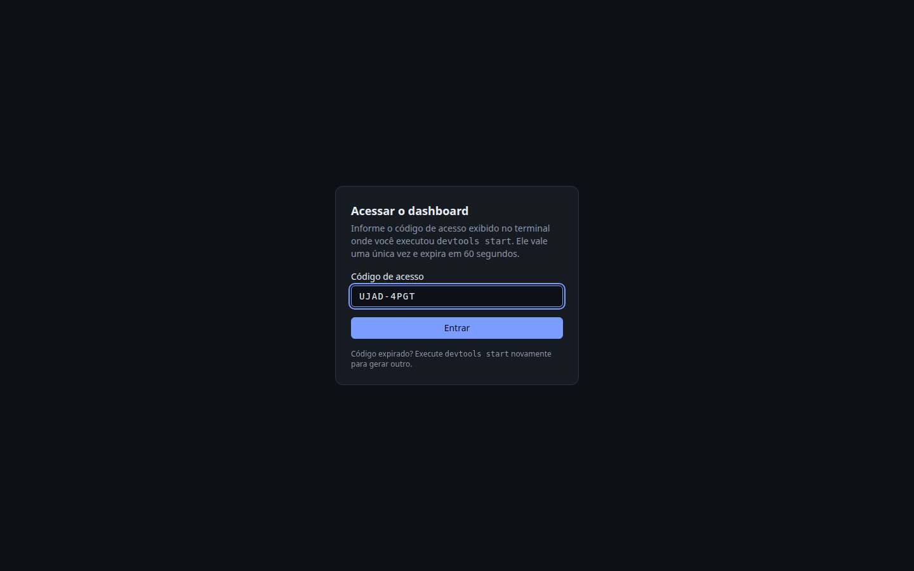

Depois de entrar, o menu lateral leva a todas as telas. No rodapé ficam o resumo das cotas, o botão de tema (claro ou escuro) e o **Sair**.

## 3. Projetos

Cadastre o **caminho absoluto** de um diretório local e, se quiser, um nome. A suíte lê só os manifestos (`package.json`, `pom.xml`, `angular.json` etc.) para detectar a stack, na raiz e até dois níveis abaixo, como `frontend/` e `backend/`. Nenhum arquivo do projeto é alterado.

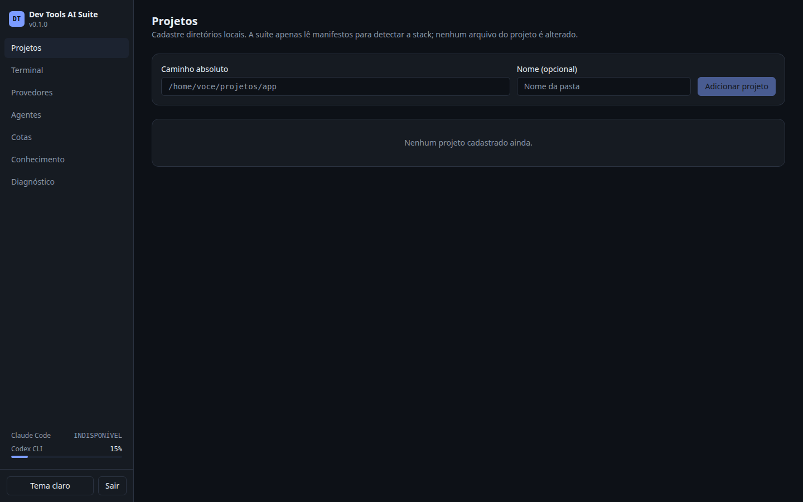

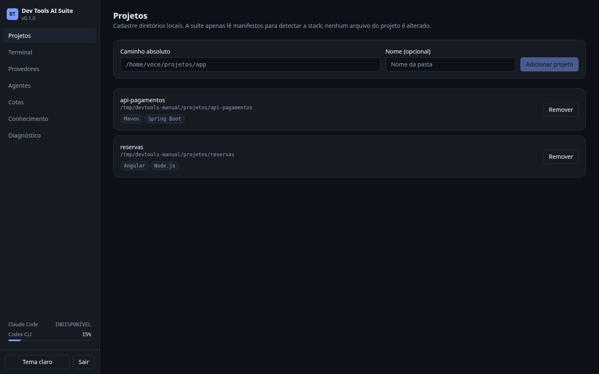

Ao abrir um projeto, você vê a stack, as sessões de agentes recentes e os atalhos para terminal, Claude Code, Codex e Conhecimento.

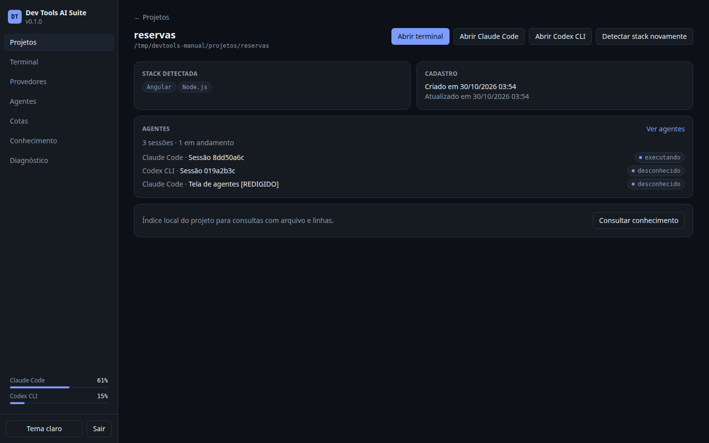

## 4. Terminal

**Abrir terminal** cria um shell real no diretório do projeto. Aplicativos interativos funcionam normalmente. Cada aba é um processo; **+ Novo** abre outro shell e **+ Claude**/**+ Codex** abrem o assistente numa aba nova.

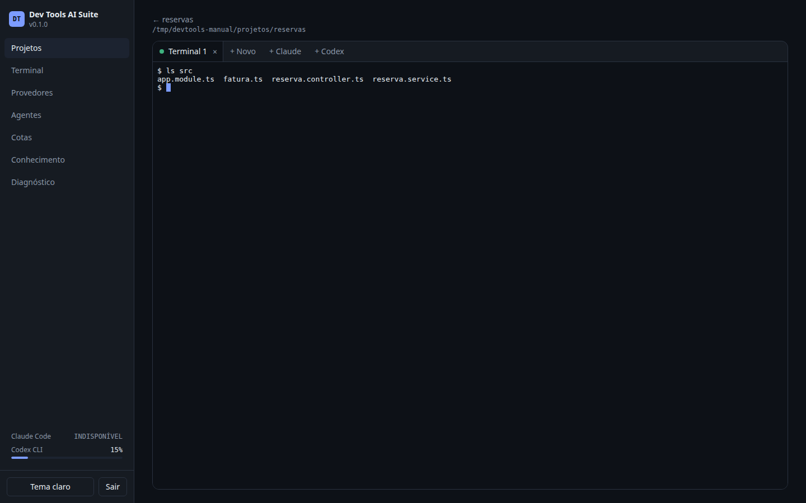

- Fechar o navegador **não** encerra os terminais: eles ficam vivos por até 8 horas e você retoma de onde parou.
- Fechar a aba (×) ou parar a suíte encerra o processo.
- A tela **Terminal** do menu lista os projetos para abrir um terminal direto.

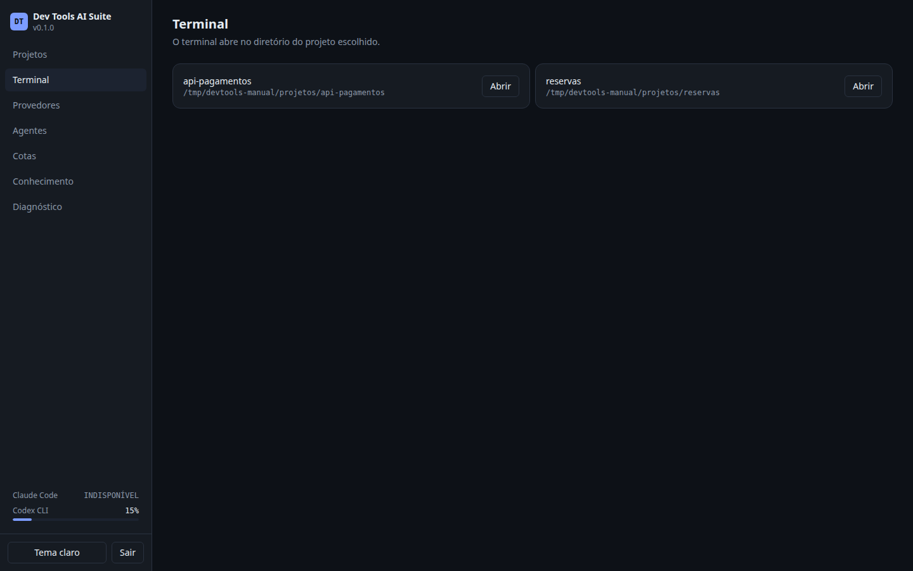

## 5. Claude Code e Codex

**Abrir Claude Code** e **Abrir Codex CLI**, no projeto ou nas abas do terminal, iniciam o assistente já no diretório certo.

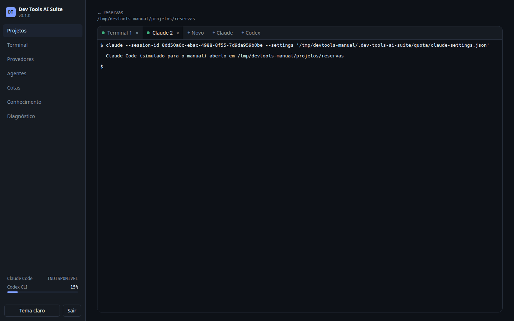

O login é sempre feito pelos comandos oficiais (`claude auth login`, `codex login`), num terminal da própria suíte ou no seu. A suíte **não lê, copia nem guarda** credenciais dos provedores.

Nas sessões do Claude Code abertas pela suíte, ela configura uma *status line* que informa o uso das cotas. Para desligar, inicie com `DEVTOOLS_CLAUDE_STATUSLINE=off`; as cotas do Claude passam a aparecer como INDISPONÍVEL.

## 6. Provedores

Mostra o que foi detectado na máquina: versão, estado do login e o que a suíte consegue observar de cada ferramenta. A detecção usa só comandos oficiais (`claude --version`, `claude auth status`, `codex login status`).

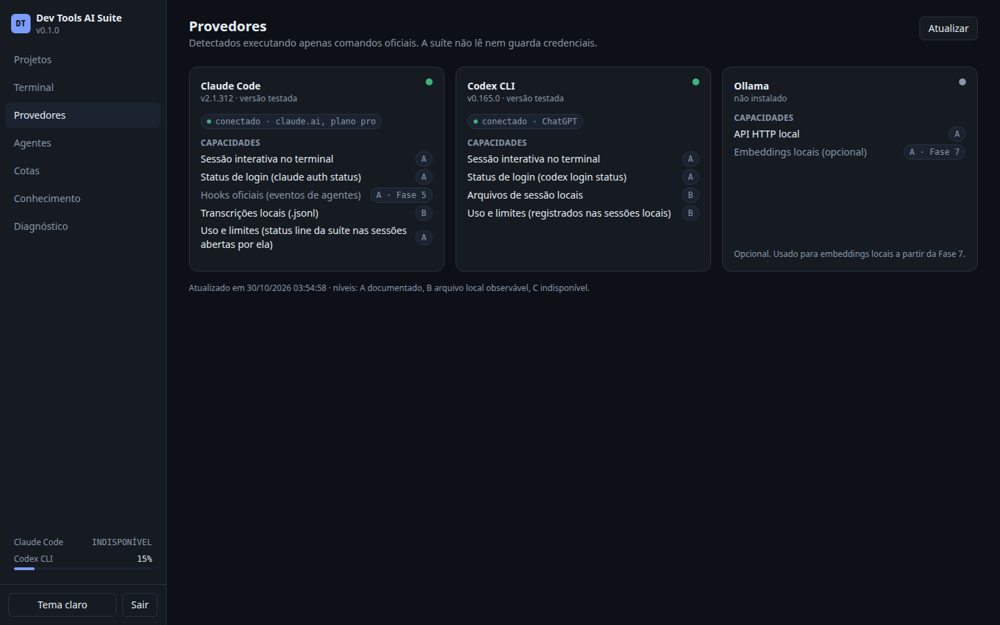

As letras ao lado de cada capacidade indicam a origem da informação:

| Nível | Significado |
|---|---|
| **A** | comando ou recurso documentado pelo provedor |
| **B** | arquivo local observável (transcrições e sessões gravadas pela ferramenta) |
| **C** | indisponível |

## 7. Agentes

Lista as sessões do Claude Code e do Codex no projeto escolhido, lidas das transcrições locais e atualizadas ao vivo. Para cada sessão, a tela mostra:
- estado, modelo, versão, início, último evento e duração;
- tokens (entrada, saída e cache);
- ferramentas chamadas;
- subagentes.

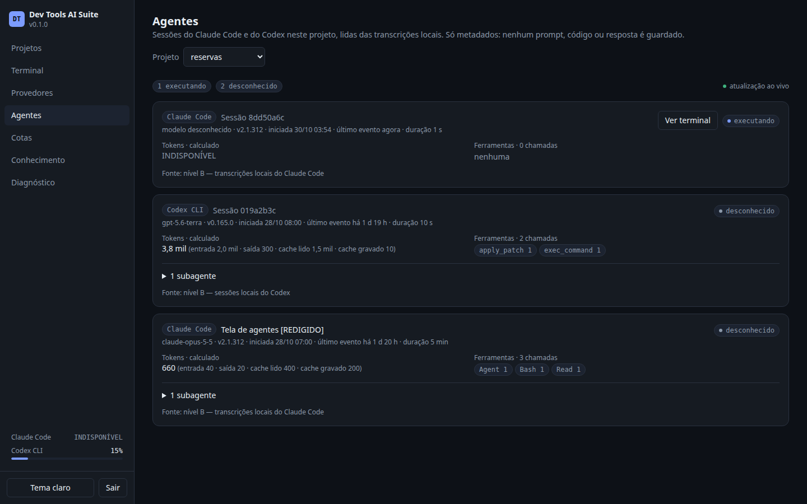

- São guardados **só metadados**: nenhum prompt, código ou resposta. Títulos com algo parecido com um segredo aparecem como `[REDIGIDO]`.
- Sessões abertas pela suíte têm o botão **Ver terminal**, que leva de volta à aba delas.
- Quando a suíte não consegue afirmar algo (o estado de uma sessão antiga, por exemplo), mostra **desconhecido** ou **INDISPONÍVEL**. Nada é inventado.

## 8. Cotas

Mostra as janelas de uso (5 horas e semanal) **exatamente como cada provedor informou**, com a fonte, o horário da medição e o da renovação.

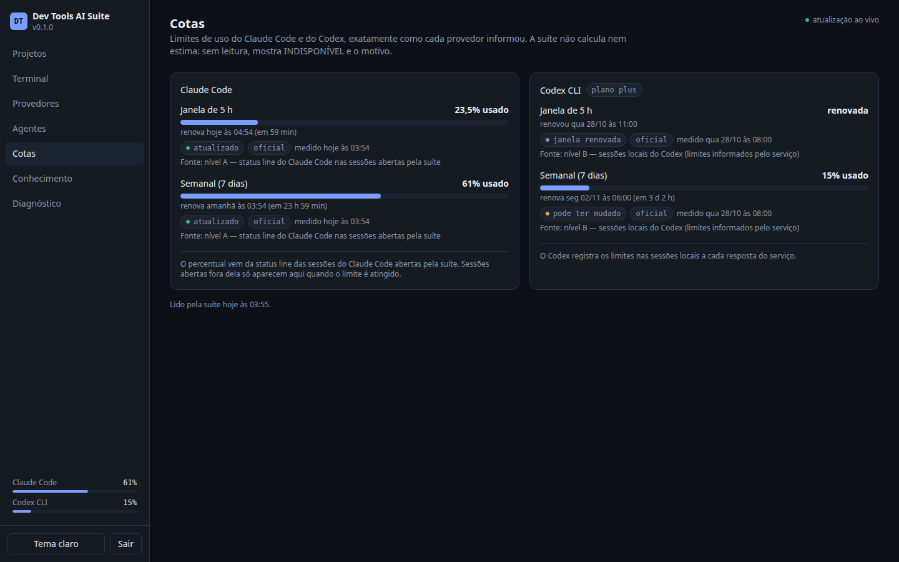

| Selo | Significado |
|---|---|
| `atualizado` | leitura recente |
| `pode ter mudado` | a leitura é antiga; o uso real pode ser outro |
| `janela renovada` | o horário de renovação já passou |
| `oficial` | o número veio do próprio provedor |

- **Claude Code:** o uso chega pela status line das sessões abertas pela suíte. Sessões abertas fora dela só aparecem quando o limite é atingido. Login por chave de API não tem essas janelas.
- **Codex:** o uso vem dos limites que o serviço registra nas sessões locais a cada resposta.
- Sem leitura verificável, a cota aparece como **INDISPONÍVEL**, com o motivo. A suíte não calcula nem estima.

## 9. Conhecimento

Índice local do projeto para perguntar ao código e receber trechos com **arquivo e linhas**. Escolha o projeto no canto superior direito.

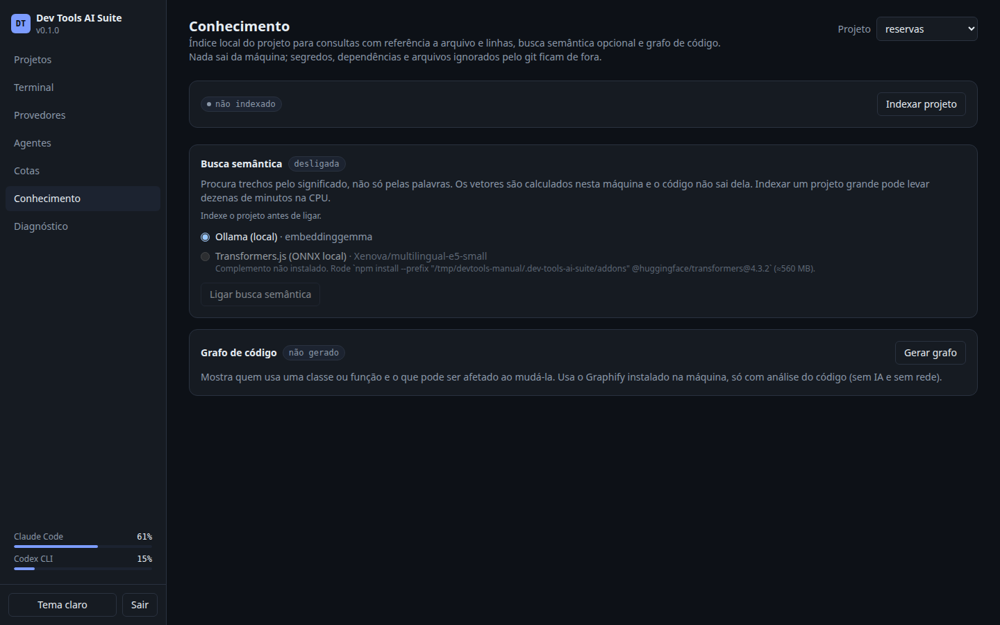

### Busca textual

**Indexar projeto** cria o índice. Ficam de fora:
- arquivos sensíveis (`.env`, chaves, credenciais);
- dependências, build e mídia;
- arquivos ignorados pelo git;
- binários e arquivos maiores que 1 MiB.

O resumo mostra quantos ficaram de fora em cada caso. Depois é só buscar.

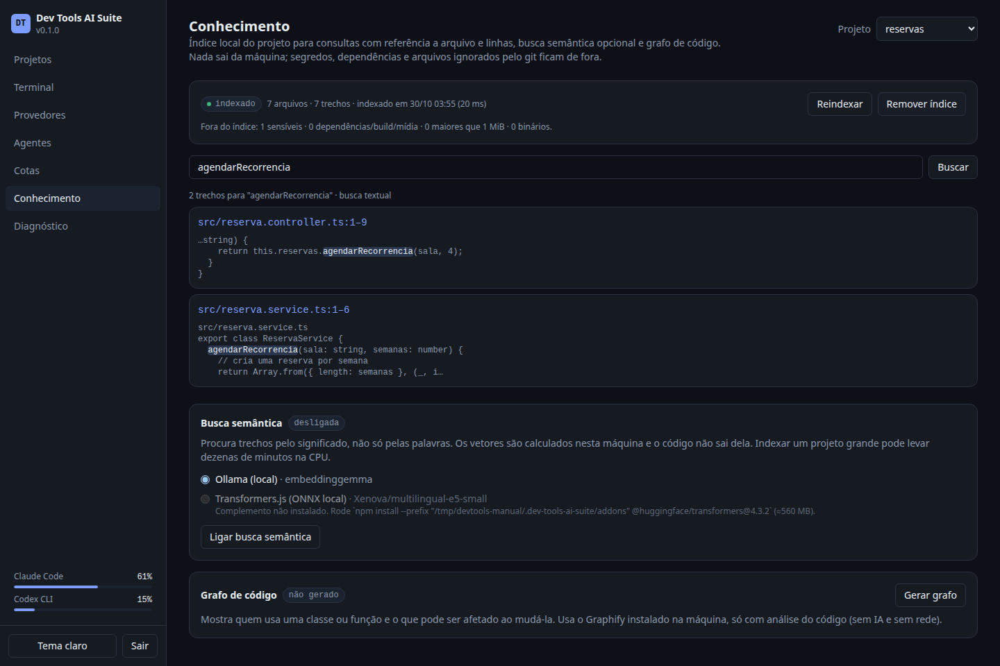

### Busca semântica (opcional)

Procura pelo significado, não só pelas palavras. Os vetores são calculados **nesta máquina**, por um destes motores:
- **Ollama local** (recomendado): o modelo padrão é `embeddinggemma`, e o Ollama precisa estar em `127.0.0.1`.
- **Transformers.js**: complemento instalado à parte. O modelo só é baixado depois da sua confirmação.

Escolha o motor e clique em **Ligar busca semântica**. Depois, selecione **Semântica** (ou a híbrida) no tipo de busca.

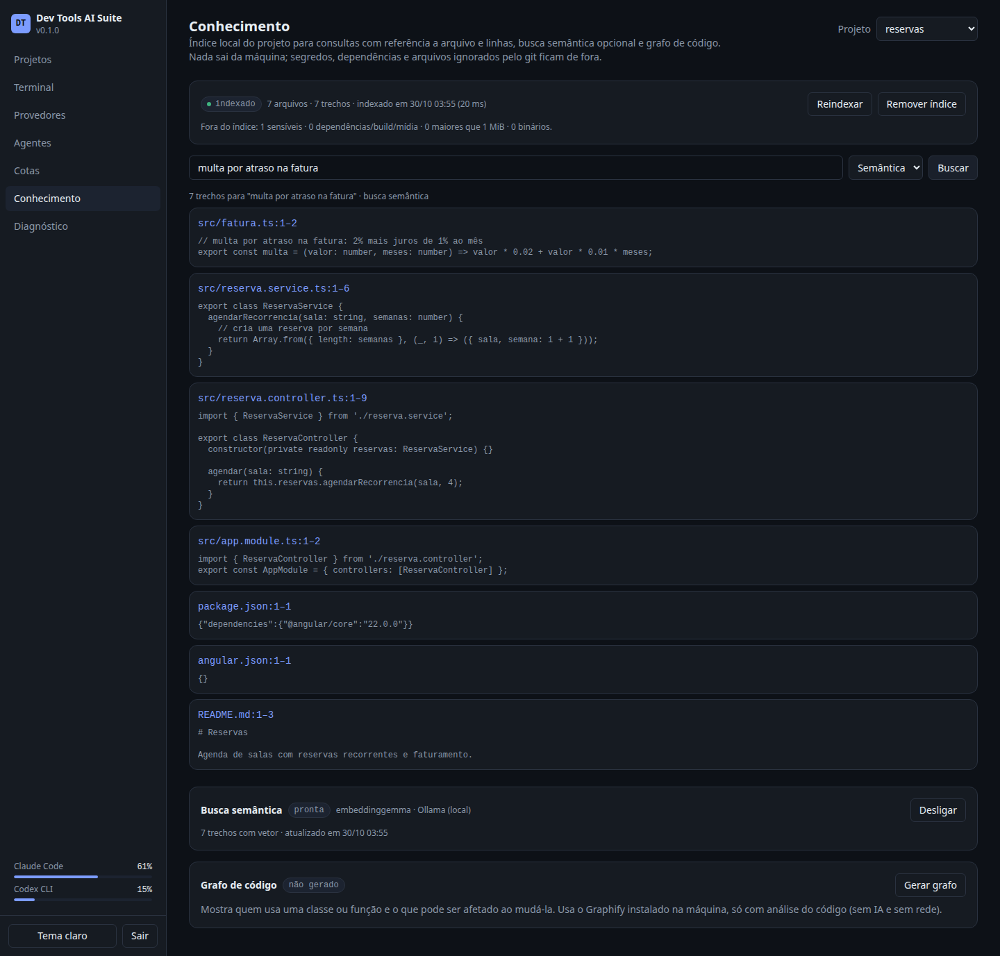

### Grafo de código (opcional)

Com o [Graphify](https://github.com/safishamsi/graphify) instalado (`pipx install graphifyy`), **Gerar grafo** analisa o código sem IA e sem rede. Digite um símbolo e clique em **Analisar** para ver:
- quem usa o símbolo;
- o que ele usa;
- o impacto de uma mudança, com arquivo e linha.

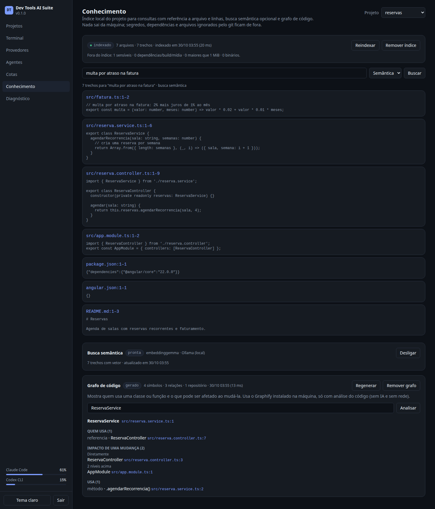

Os botões **Reindexar**, **Remover índice**, **Desligar** e **Remover grafo** gerenciam o que foi criado. Remover o projeto apaga também os índices.

## 10. Diagnóstico

Equivale ao `devtools doctor`. À esquerda, a saúde da instalação: Node.js, diretório de dados e permissões, segredo, banco e terminal. À direita, as ferramentas opcionais e o estado de login de cada uma.

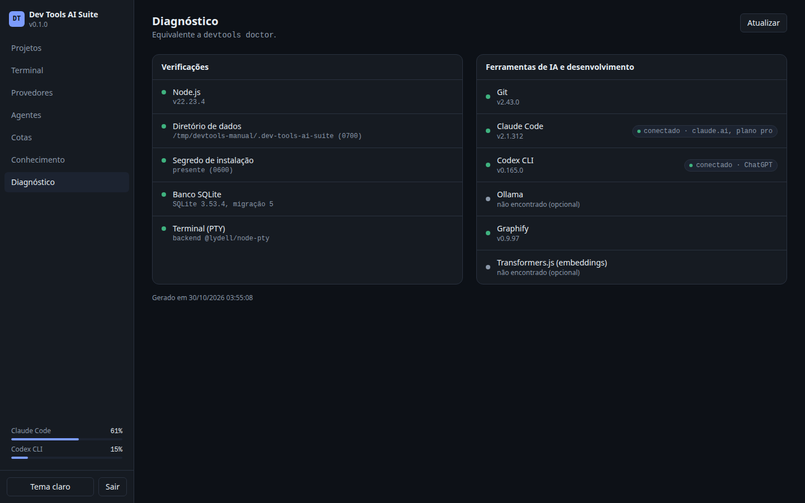

No terminal, `devtools doctor --json` gera a mesma saída para scripts. O comando sai com código 1 se alguma verificação falhar.

## 11. Segurança e privacidade

- A suíte escuta só em `127.0.0.1`. Cada acesso exige uma sessão local: o código de uso único vira um cookie `HttpOnly`, com proteção de Host, Origin e CSRF.
- Nenhuma pessoa ou aplicação externa executa comandos na sua máquina só porque a suíte está instalada.
- Credenciais de Claude, Codex ou outros provedores nunca são lidas, copiadas nem transmitidas.
- Nada é gravado dentro dos seus projetos. Os dados ficam em `~/.dev-tools-ai-suite/` (0700, arquivos sensíveis 0600), e os logs saem com segredos redigidos.
- O código não sai da máquina: o Ollama precisa ser local, e o modelo do Transformers.js só é baixado com o seu consentimento.

## 12. Problemas comuns

| Sintoma | O que fazer |
|---|---|
| O código de acesso expirou | Rode `devtools start` de novo para gerar outro |
| Porta ocupada | Se for a própria suíte, `devtools start` só gera um novo código; senão use `--port` |
| Provedor "não encontrado", mas funciona no seu terminal | Inicie a suíte num shell com o PATH completo |
| Cota do Claude como INDISPONÍVEL | Abra o Claude Code **pela suíte** e envie uma mensagem; login por chave de API não tem janelas de uso |
| Terminal (PTY) com erro no Diagnóstico | Reinstale a suíte; se persistir, instale `build-essential` e `python3` |
| Busca semântica lenta | Os embeddings rodam na CPU; prefira o Ollama ou deixe indexando em segundo plano |
| `O banco de dados é da migração N, mais nova…` | A suíte é mais antiga que os dados: atualize-a (`npm install -g devtools-ai-suite@latest`) ou restaure o backup |

Para atualizar: `npm install -g devtools-ai-suite@latest`. As migrações do banco rodam sozinhas. Para desinstalar: `npm uninstall -g devtools-ai-suite`. Os dados ficam até você apagar `~/.dev-tools-ai-suite`.

Variáveis de ambiente, backup e estrutura de dados: [guia de operação](../../vault/09_OPERATIONS/OPERATIONS.md).
