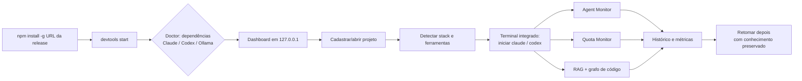

# Jornadas do Usuário

## J1 — Jornada principal
**Instalar → Configurar → Abrir projeto → Executar agentes → Monitorar → Aproveitar conhecimento**

Passos:
1. Instala a suíte.
2. Instalador verifica dependências e detecta Claude Code, Codex e Ollama.
3. Configura integrações disponíveis respeitando autenticação e permissões (alterações em projetos só com autorização — RN-05).
4. Abre o dashboard no navegador (endereço local).
5. Seleciona ou cadastra um diretório de projeto.
6. Plataforma identifica stack, ferramentas e configurações.
7. Abre o terminal integrado e inicia uma sessão de IA.
8. Acompanha agente principal e subagentes no Agent Monitor.
9. Consulta limites no AI Quota Monitor.
10. Usa conhecimento indexado (RAG e grafo).
11. Consulta histórico, métricas e resultados.
12. Retoma depois preservando conhecimento e configurações.

Critério: trabalhar diariamente **sem abrir terminal externo**. Não precisa substituir uma IDE no MVP.

## J2 — Diagnóstico
`devtools doctor` → lista ferramentas detectadas, versões, estado de autenticação (via mecanismos documentados), permissões do diretório de dados e módulos opcionais indisponíveis — sem impedir o uso do Core.

## J3 — Remoção de dados de um projeto
Usuário remove índices/histórico de um projeto → confirmação explícita → dados removidos apenas daquele projeto (isolamento).
