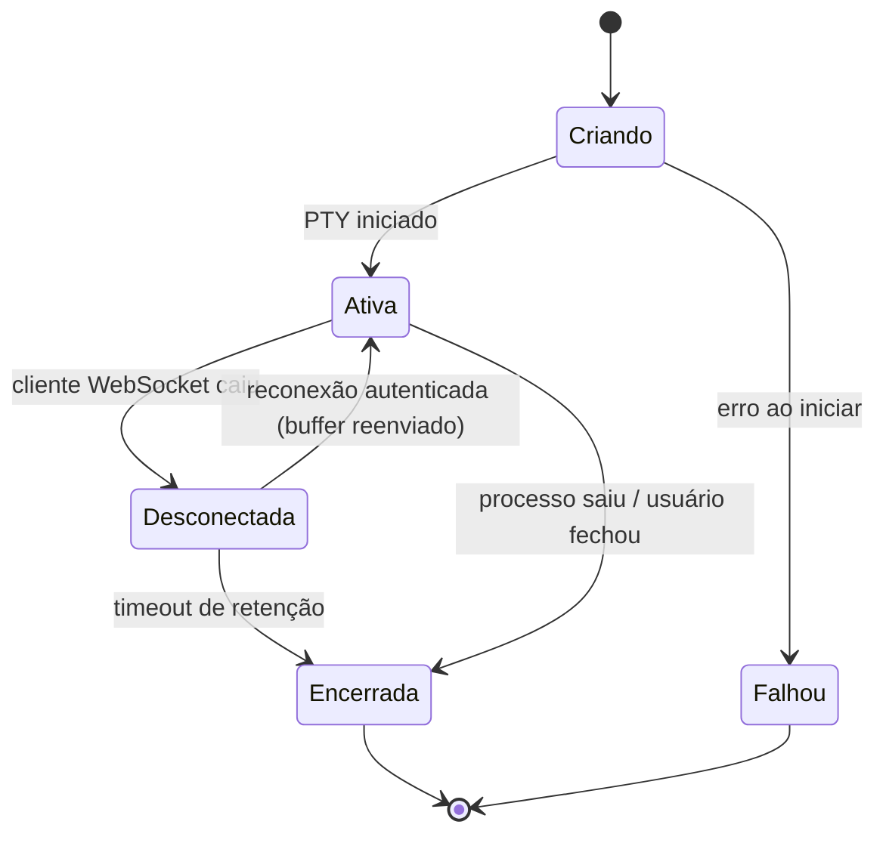
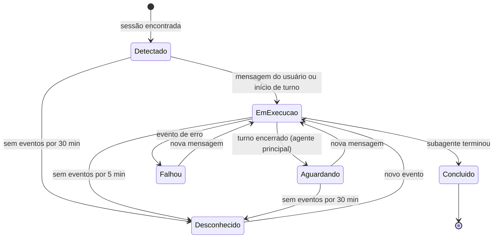
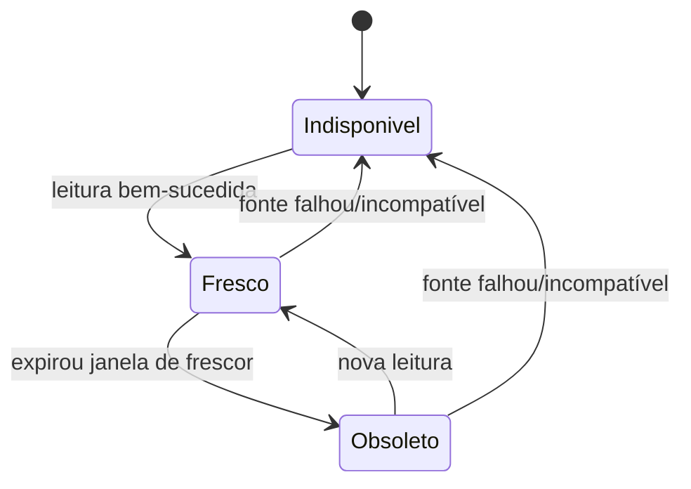
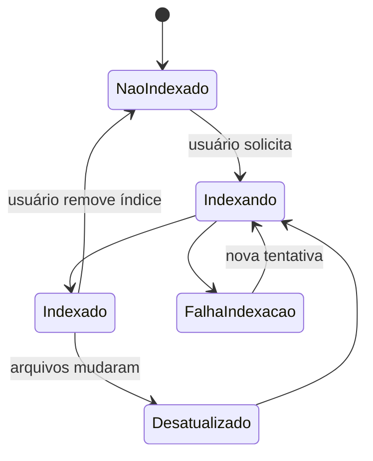
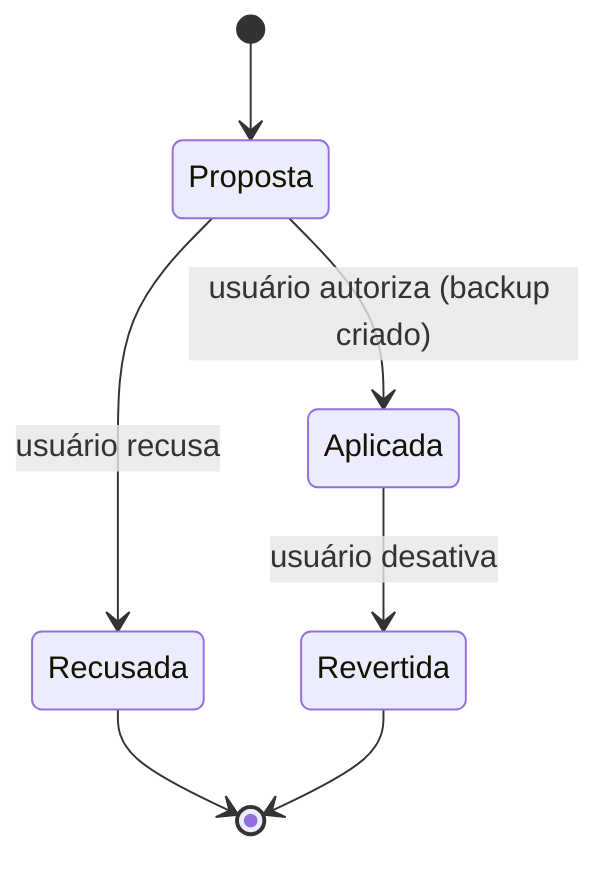

# Máquinas de Estado

> Modelos iniciais (hipóteses) para orientar a Fase 2+. Ajustes exigem atualização deste arquivo.

## Sessão de terminal

Regra: sessão `Desconectada` mantém o processo vivo e um buffer limitado de saída (256 KiB) até o timeout de retenção de **8 h**. Sessão `Encerrada` continua listada por 10 min para a aba mostrar o código de saída. Encerrar a sessão encerra toda a árvore de processos dela (descendentes e processos da mesma sessão POSIX). Na API: `active` = Ativa, `disconnected` = Desconectada, `exited` = Encerrada; `Falhou` vira erro na criação (sem sessão).

## Execução de agente (Agent Monitor)

`Desconhecido` existe para cumprir INV-03: sem evento, não se presume estado. As fontes atuais (transcrições, nível B) não registram o fim de uma sessão principal: por isso ela termina em `Aguardando` ou `Desconhecido`, nunca em `Concluído` presumido.

| Estado (`AgentRunState`) | Evidência observada | Limite de frescor |
|---|---|---|
| `detected` — Detectado | sessão existe, sem turnos | 30 min |
| `running` — Em execução | último registro é de trabalho (mensagem, ferramenta, início de turno) | 5 min |
| `waiting` — Aguardando | turno encerrado (`end_turn`, `task_complete`, interrupção do usuário) | 30 min |
| `completed` — Concluído | subagente encerrou o turno | — |
| `failed` — Falhou | último evento é erro | — |
| `unknown` — Desconhecido | limite de frescor excedido ou servidor reiniciado antes da releitura | — |

Implementação: `deriveState` em `apps/server/src/modules/integrations/sources/run-snapshot.ts` ([[ADR-0013-fontes-agent-monitor]]).

## Dado de cota/telemetria

Cada leitura carrega `categoria ∈ {oficial, calculado, estimado}`; `indisponível` é estado, não valor.

## Indexação de projeto

## Alteração de configuração de projeto (RN-05)

