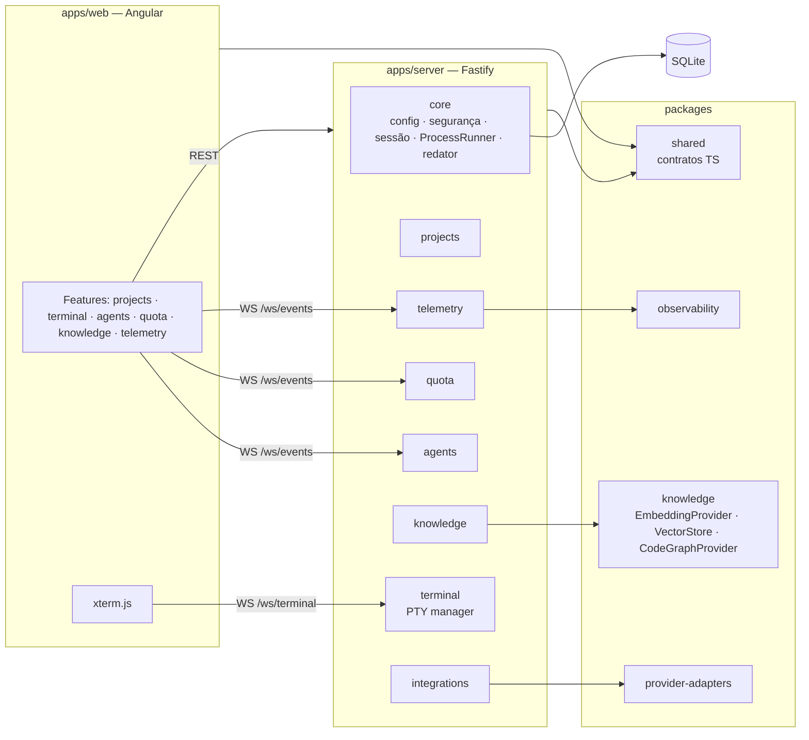

# Arquitetura

**Estilo:** monólito modular com portas e adaptadores **somente nas fronteiras externas** → [[ADR-0001-monolito-modular]].

> Arquitetura deve reduzir complexidade, não demonstrar conhecimento.

Sem microserviços, mensageria distribuída, CQRS ou hexagonal completa no MVP.

## Contêineres (C4 nível 2)

## Portas (contratos substituíveis)
| Porta | Responsabilidade | Implementações MVP |
|---|---|---|
| `ProviderAdapter` | detectar, versão, capacidades, comando de execução, fontes de eventos/uso | `claude-code`, `codex` (+ `ollama` para detecção) |
| `EmbeddingProvider` | gerar embeddings localmente | `onnx` (Transformers.js), `ollama` |
| `VectorStore` | armazenar/consultar vetores por projeto | `sqlite-vec` ou `lancedb` (S-03) |
| `CodeGraphProvider` | grafo estrutural do código | `graphify` (processo externo) |

Fora dessas portas, módulos usam código direto e simples.

## Fluxos principais
- **Terminal:** browser ↔ WS autenticado ↔ `terminal` ↔ `node-pty` ↔ shell do usuário, `cwd` = diretório do projeto.
- **Agent Monitor:** `integrations` lê fontes permitidas (RN-03) → normaliza em `AgentEvent` → `agents` persiste e publica em `/ws/events`.
- **Quota:** `quota` agenda leituras por provider → `QuotaReading` com categoria e frescor → UI.
- **Knowledge:** `knowledge` varre projeto (com exclusões) → chunks → `EmbeddingProvider` → `VectorStore`; consulta retorna chunks com referência verificável.

## Princípios
1. Core inicia mesmo sem módulos opcionais (G-05, RN-06).
2. Toda borda externa tem timeout, log redigido e erro tipado.
3. Contratos compartilhados em `packages/shared` (fonte única para server e web).
4. Dados de provedores sempre com proveniência (INV-03, G-06).
5. Nenhum módulo acessa internals de outro; comunicação por interface pública do módulo.

Sequência de segurança da sessão: [[ADR-0007-seguranca-local]]. Modelo de dados: [[DATA_MODEL]].
