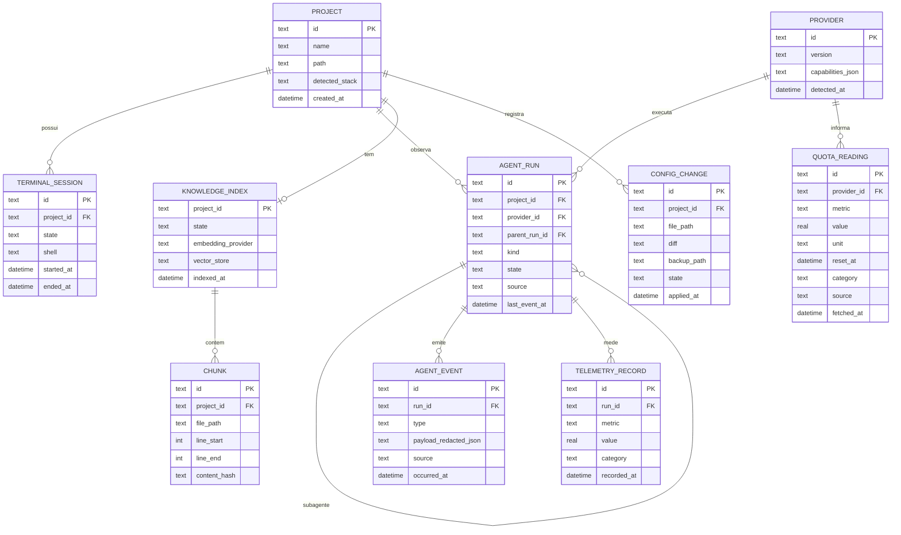

# Modelo de Dados (inicial)

> Esboço para a Fase 2. Esquema definitivo nasce com migrações versionadas no `core`.



## Regras
- Payloads de eventos são **redigidos** antes de persistir.
- `category` em `QUOTA_READING`/`TELEMETRY_RECORD` ∈ {oficial, calculado, estimado}; ausência é representada pela falta de leitura válida → UI mostra `INDISPONÍVEL`.
- Vetores ficam no `VectorStore` (tabela virtual sqlite-vec ou diretório LanceDB por projeto), referenciando `CHUNK.id`.
- Nenhuma credencial é armazenada (INV-02). O segredo de instalação fica em arquivo próprio 0600, não no banco.

## Diretório de dados
```text
~/.dev-tools-ai-suite/
├── config.yaml
├── secret            (0600)
├── devtools.db       (SQLite)
├── indexes/<project-id>/
├── logs/
└── backups/config-changes/
```
