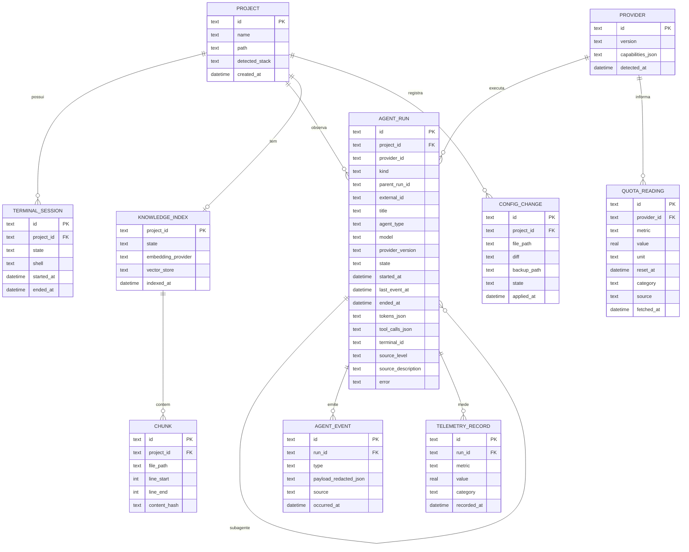

# Modelo de Dados (inicial)

> Esboço para a Fase 2. Esquema definitivo nasce com migrações versionadas no `core`.



## Regras
- Payloads de eventos são **redigidos** antes de persistir.
- `AGENT_RUN` (migração 3, `agent_runs`): id = `<provedor>:<id externo>` ou `<provedor>:<sessão>:<subagente>`. Guarda só metadados (título e descrição redigidos e truncados); tokens são **calculados** a partir dos registros do provedor. `AGENT_EVENT` (`agent_events`) registra cada mudança de estado (`{state, previous}`). Ao iniciar, execuções `running`/`waiting`/`detected` viram `unknown` até a releitura (INV-03). Remover o projeto apaga o histórico (`ON DELETE CASCADE`).
- `category` em `QUOTA_READING`/`TELEMETRY_RECORD` ∈ {oficial, calculado, estimado}; ausência é representada pela falta de leitura válida → UI mostra `INDISPONÍVEL`.
- `QUOTA_READING` **não é persistido no MVP** (D-16): as leituras são recalculadas a cada 5 s a partir das fontes em disco (sessões do Codex, transcrições do Claude e `<dados>/quota/claude-statusline.json`, gravado pela status line da suíte). O tipo exposto é `QuotaResponse`/`QuotaWindow` (`packages/shared`).
- `KNOWLEDGE_INDEX` (migração 4, `knowledge_indexes`) guarda só o estado e as contagens. Arquivos e trechos (`CHUNK`) ficam no índice do próprio projeto, `indexes/<projeto>.db` (tabelas `files` e `chunks` FTS5), removido com o índice ou com o projeto (D-18).
- Vetores (migração 5, `knowledge_semantic` guarda mecanismo, modelo, estado e progresso) ficam em `indexes/<projeto>.vec.db` (0600, `sqlite-vec`): tabela `refs` (hash do trecho, arquivo, linhas, prévia redigida) e tabela virtual `vectors` (`vec0`, cosseno). O hash de caminho + linhas + conteúdo permite recalcular só os trechos que mudaram; trocar de modelo descarta os vetores.
- Grafo de código (migração 5, `knowledge_graphs` guarda estado e contagens) fica em `graphs/<projeto>.json` (0600): só símbolos, arquivos, linhas e relações extraídos pelo Graphify; símbolos de arquivos excluídos não entram.
- Nenhuma credencial é armazenada (INV-02). O segredo de instalação fica em arquivo próprio 0600, não no banco.

## Diretório de dados
```text
~/.dev-tools-ai-suite/
├── config.yaml
├── secret            (0600)
├── devtools.db       (SQLite)
├── indexes/<project-id>/
├── logs/
└── backups/config-changes/
```
