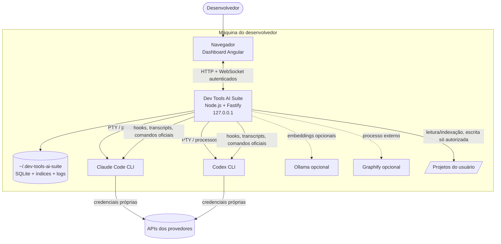

# Visão Geral do Sistema

## Contexto (C4 nível 1, simplificado)

A suíte **nunca** fala com as APIs dos provedores usando credenciais deles (INV-02).

## Stack
| Camada | Tecnologia | ADR |
|---|---|---|
| Frontend | Angular + TypeScript + Tailwind CSS + Angular CDK, tema escuro padrão | [[ADR-0003-frontend-angular]] |
| Backend | Node.js 22 + TypeScript strict + Fastify + `ws` | [[ADR-0002-backend-node-fastify]] |
| Terminal | `xterm.js` + `node-pty` + WebSocket | [[ADR-0004-terminal-web]] |
| Persistência | SQLite em `~/.dev-tools-ai-suite/` | [[ADR-0005-persistencia-sqlite]] |
| Vetores | `sqlite-vec` (D-20) | [[ADR-0006-rag-local]] |
| Embeddings | `EmbeddingProvider` opcional: Ollama local ou Transformers.js instalado sob demanda | [[ADR-0006-rag-local]] |
| Grafo de código | `CodeGraphProvider` → Graphify externo opcional (`--code-only`) | [[ADR-0006-rag-local]] |
| Monorepo | pnpm workspaces | [[MONOREPO_STRUCTURE]] |
| Qualidade | ESLint, Prettier, Vitest, Playwright | [[TEST_STRATEGY]] |
| Distribuição | npm (`devtools`), Linux homologado | [[ADR-0008-distribuicao-npm]] |

Detalhes: [[ARCHITECTURE]] · [[MODULE_MAP]]
