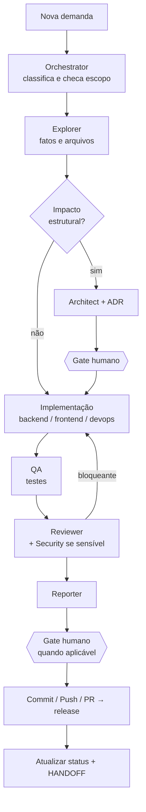

# Workflow de Desenvolvimento

Etapas formais completas: INTAKE → DISCOVERY → PLANEJAMENTO → ARQUITETURA → IMPLEMENTAÇÃO → TESTES → REVISÃO → HOMOLOGAÇÃO → COMMIT/PUSH → RELEASE.

**Proporcionalidade:** nem toda mudança atravessa todas as etapas. Classes de demanda e fluxos em `.ai/workflow/START.md`.

## Exemplos
- *"Corrigir typo no README"* → Trivial → implementação → commit.
- *"Terminal não reconecta após suspender o notebook"* → Pequena/Padrão → Explorer localiza `terminal` → teste que reproduz → correção → QA_TERMINAL → Reviewer → PR.
- *"Mudar mecanismo de sessão do navegador"* → **Sensível** → Architect + Security Engineer → ADR-0007 atualizado → **gate humano** → implementação → revisão de segurança bloqueante → PR.
- *"Adicionar suporte ao Gemini CLI"* → fora do MVP → registrar em [[POST_MVP_BACKLOG]].
