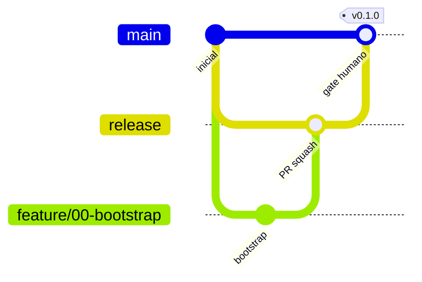

# GitFlow

| Branch | Papel | Proteção |
|---|---|---|
| `main` | versões publicadas | sem commit direto; merge só de `release` com gate humano; CI obrigatório |
| `release` | integração e homologação | PR obrigatório; CI obrigatório |
| `feature/*` `fix/*` `chore/*` | trabalho | partem de `release`, PR para `release` |

- Commits: Conventional Commits, descrição em PT-BR. Ex.: `feat(terminal): adiciona reconexão de sessão`.
- Versionamento: SemVer, tags `vX.Y.Z` → [[VERSIONING]].
- Merge em `release`: squash. `release → main`: merge commit.

## Permissões das LLMs
| Operação | Permissão |
|---|---|
| Criar branches de trabalho, alterar arquivos, testes/builds, commits, push em branches de trabalho, abrir PR | Sim |
| Merge em `release` | Sim, após gates técnicos e revisão |
| Merge em `main`, tags/releases oficiais, publicar npm | Somente com aprovação humana |
| Alterar proteção de branches, segredos ou permissões do GitHub | Somente com aprovação humana |
| Excluir branches remotas protegidas | Não |

## Proteção de branches (aplicada em 2026-10-28, HG-11)
`main` e `release`: PR obrigatório (0 aprovações — mantenedor único), check **Validação** obrigatório, conversas resolvidas, sem force-push, sem exclusão. Administradores podem contornar em emergência (`enforce_admins: false`).
