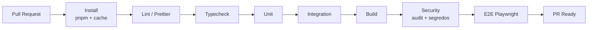

# CI/CD

Plataforma: **GitHub Actions**, runner `ubuntu-24.04`. Implementado em `.github/workflows/ci.yml` (Fase 2), job **Validação**.

- Node e pnpm com versões fixadas; lockfile versionado; cache de dependências.
- Validar build e testes com **PTY real** no runner.
- Relatórios de falha e artefatos (Playwright report, logs).
- **Nunca** publicar a partir de PR.
- Workflow de release (manual, `workflow_dispatch`) com environment protegido exigindo aprovação humana → `npm publish --tag next`; promoção para `latest` também manual.
- Checks obrigatórios configurados na proteção de `main` e `release`.

## Etapas implementadas
`pnpm install --frozen-lockfile` → `format:check` → `lint` → `typecheck` → `test` → `build` → `check:secrets` → `pnpm audit --prod --audit-level high` → `validate:bootstrap` → Playwright (Chromium) → `test:e2e` → `pnpm pack` com verificação do conteúdo do pacote (sem publicar). Relatório do Playwright é anexado em caso de falha.

Ainda não implementado: workflow de release com environment protegido (Fase 9).
