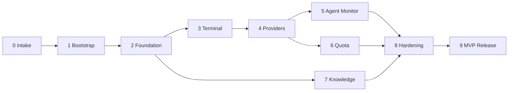

# Plano de Desenvolvimento

> Fonte da verdade do roadmap. `docs/development-plan.html` é derivado deste arquivo e deve ser atualizado na mesma mudança.

Filosofia: **IDEA → MVP → HOMOLOGAÇÃO → FEEDBACK → POLISH**. Toda fase tem início e fim claros. Iniciar fase = gate humano HG-14. Melhorias fora da fase → [[POST_MVP_BACKLOG]].

Status possíveis: `Não iniciado` · `Em andamento` · `Bloqueado` · `Em validação` · `Concluído`.

| Fase | Nome | Prioridade | Status | Progresso |
|---|---|---|---|---|
| 0 | Intake e Discovery | — | Concluído | 100% |
| 1 | Bootstrap | — | Em validação | 90% |
| 2 | Foundation | P0 | Não iniciado | 0% |
| 3 | Integrated Terminal (SUG03) | P0 | Não iniciado | 0% |
| 4 | Provider Integration | P0 | Não iniciado | 0% |
| 5 | Agent Monitor + Telemetria (SUG01) | P1 | Não iniciado | 0% |
| 6 | AI Quota Monitor (SUG02) | P1 | Não iniciado | 0% |
| 7 | Knowledge (RAG + Grafo) | P1 | Não iniciado | 0% |
| 8 | Hardening e Validação | — | Não iniciado | 0% |
| 9 | MVP Release | — | Não iniciado | 0% |

F5, F6 e F7 podem correr em paralelo após suas dependências, se a capacidade permitir.

---

## FASE 0 — Intake e Discovery
**Status:** Concluído
- **Objetivo:** transformar a ideia em definição clara de MVP.
- **Escopo:** 4 blocos do Intake; ambiente verificado.
- **Entregáveis:** [x] [[INTAKE_RECORD]] · [x] decisões de stack/arquitetura · [x] DoD do MVP.
- **Dependências:** —
- **Critérios de aceite:** [x] proposta consolidada aprovada pelo humano.
- **DoD:** gate humano de aprovação do bootstrap registrado.
- **Riscos:** spikes técnicos pendentes → migrados para as fases 2, 5, 6 e 7.

## FASE 1 — Bootstrap
**Status:** Em validação
- **Objetivo:** fundação documental e operacional para desenvolvimento multi-LLM.
- **Escopo:** Vault, `.ai/`, adapters, agentes, contratos, skills, hooks, GitFlow, roadmap, HTMLs, manual, README, esqueleto do monorepo. **Sem código de produto.**
- **Entregáveis:**
  - [x] `vault/` com 16 áreas e START_HERE
  - [x] `.ai/` (workflow, agentes, contratos, skills, hooks, prompts, templates, adapters, estado)
  - [x] `CLAUDE.md`, `AGENTS.md`, `.claude/`, `.agents/`
  - [x] `.githooks/` e `scripts/`
  - [x] `docs/development-plan.html` e `docs/ai-development-system.html`
  - [x] [[AI_DEVELOPMENT_MANUAL]] e README
  - [x] ADR-0001 a ADR-0011
  - [ ] PR `feature/00-bootstrap → release` aprovado e mergeado
- **Dependências:** Fase 0.
- **Critérios de aceite:** [x] `scripts/validate-bootstrap.sh` passa · [ ] revisão humana do PR.
- **DoD:** PR mergeado em `release`; status e handoff atualizados.
- **Riscos:** documentação excessiva → mitigado pela regra de documentação mínima útil.

## FASE 2 — Foundation (P0)
**Status:** Não iniciado
- **Objetivo:** aplicação instalável e segura que sobe, autentica, abre o dashboard e gerencia projetos.
- **Escopo:** tooling (TS strict, ESLint, Prettier, Vitest, Playwright) · CI GitHub Actions · proteção de branches (HG-11) · `apps/server` Fastify com `core` (config, diretório de dados, segredo, sessão — ADR-0007, logger, redator, `ProcessRunner`, migrações SQLite) · `apps/web` Angular shell + design system base + temas · módulo `projects` · CLI `devtools start` / `devtools doctor` (detecção básica).
- **Fora do escopo:** terminal, agentes, cotas, RAG.
- **Entregáveis:** monorepo compilando; CI verde; dashboard autenticado listando/cadastrando projetos; `doctor` funcional.
- **Dependências:** Fase 1; spike **S-01** (node-pty/prebuilds e driver SQLite) no início da fase.
- **Critérios de aceite:**
  - [ ] Servidor só aceita conexões em `127.0.0.1`.
  - [ ] Requisições sem sessão → 401; `Origin`/`Host` inválidos → 403 (testes de integração).
  - [ ] Segredo com permissão 0600; ausente de logs, URLs e bundle (teste automatizado).
  - [ ] Cadastro de projeto persiste após reinício.
  - [ ] Core inicia sem Ollama/Graphify.
  - [ ] CI executa lint, typecheck, unit, integration, build e E2E smoke.
- **DoD:** critérios atendidos, revisão de segurança sem bloqueantes, ADR-0007 **Aceito** (HG-05/06), docs atualizadas.
- **Riscos:** R-03 (deps nativas), R-07 (tempo de setup de tooling).

## FASE 3 — Integrated Terminal / SUG03 (P0)
**Status:** Não iniciado
- **Objetivo:** terminal real no navegador, estável e seguro.
- **Escopo:** `node-pty` + `xterm.js` · WS `/ws/terminal` autenticado · múltiplas abas · resize · reconexão com buffer · `cwd` do projeto · encerramento limpo de árvores de processo · retenção de sessões desconectadas.
- **Entregáveis:** terminal funcional no dashboard; testes de integração e E2E.
- **Dependências:** Fase 2.
- **Critérios de aceite:**
  - [ ] `vim`, `htop`, `claude`, `codex` funcionam interativamente.
  - [ ] Recarregar a página reconecta à mesma sessão com saída recente.
  - [ ] WS sem sessão/Origin inválida é recusado (teste).
  - [ ] Sessões de projetos diferentes isoladas.
  - [ ] Nenhum processo órfão após encerrar sessão/servidor.
- **DoD:** E2E do terminal no CI; revisão de segurança aprovada (HG-06).
- **Riscos:** comportamento de PTY no CI; consumo de memória do buffer.

## FASE 4 — Provider Integration (P0)
**Status:** Não iniciado
- **Objetivo:** detectar e iniciar Claude Code e Codex pela plataforma.
- **Escopo:** `ProviderAdapter` (claude-code, codex, ollama-detecção) · versões e capacidades · estado de autenticação via mecanismos documentados · atalhos "Abrir Claude/Codex neste projeto" no terminal · tela de provedores.
- **Entregáveis:** `/providers`; `doctor` completo; botões de lançamento.
- **Dependências:** Fase 3.
- **Critérios de aceite:**
  - [ ] Ferramenta ausente → indicada como ausente, sem erro.
  - [ ] Nenhum arquivo de credencial lido (teste com allowlist).
  - [ ] Claude Code e Codex iniciam no `cwd` do projeto.
- **DoD:** testes de contrato por versão; docs de integração atualizadas.
- **Riscos:** mudanças de CLI entre versões.

## FASE 5 — Agent Monitor + Telemetria básica / SUG01 (P1)
**Status:** Não iniciado
- **Objetivo:** ver agentes e subagentes trabalhando, com histórico.
- **Escopo:** spike **S-04** (fontes de eventos) · normalização em `AgentEvent` · `AgentRun`/`SubagentRun` · estados conforme [[STATE_MACHINES]] · `/ws/events` · histórico · telemetria básica (duração, tokens quando disponíveis).
- **Entregáveis:** painel Agent Monitor; histórico por projeto.
- **Dependências:** Fase 4.
- **Critérios de aceite:**
  - [ ] Distingue agente com terminal de subagente só com eventos.
  - [ ] Sem evento → estado `Desconhecido`/`INDISPONÍVEL`, nunca inferido.
  - [ ] Payloads redigidos antes de persistir.
  - [ ] Fixtures de contrato para cada fonte/versão suportada.
- **DoD:** monitor confiável em sessão real com subagentes paralelos.
- **Riscos:** R-01 (formatos instáveis); possível necessidade de instalar hooks no projeto (RN-05, autorização).

## FASE 6 — AI Quota Monitor / SUG02 (P1)
**Status:** Não iniciado
- **Objetivo:** mostrar limites e renovações com honestidade sobre a origem do dado.
- **Escopo:** spike **S-05** (fontes de uso/limites) · `QuotaReading` com categoria e frescor · agendamento periódico · UI compacta.
- **Entregáveis:** painel de cotas Claude Code e Codex.
- **Dependências:** Fase 4.
- **Critérios de aceite:**
  - [ ] Todo valor exibe fonte, horário, categoria e frescor.
  - [ ] Fonte indisponível → `INDISPONÍVEL` com motivo.
  - [ ] Nenhuma API não documentada ou scraping.
- **DoD:** dados verificáveis ou indisponibilidade explícita (DoD MVP item 7).
- **Riscos:** R-02 (pouca informação oficial para planos de assinatura).

## FASE 7 — Knowledge: RAG + Grafo (P1)
**Status:** Não iniciado
- **Objetivo:** indexar projetos localmente e responder consultas com referências verificáveis.
- **Escopo:** spikes **S-02** (Graphify) e **S-03** (vetores + embeddings) · `EmbeddingProvider` (ONNX, Ollama) · `VectorStore` · exclusões · chunking · consulta com referências · remover/reconstruir índice · `CodeGraphProvider`.
- **Entregáveis:** indexação e consulta no dashboard; ADR-0006 **Aceito**.
- **Dependências:** Fase 2 (pode correr em paralelo a 3–6).
- **Critérios de aceite:**
  - [ ] Pelo menos um mecanismo de embeddings local validado.
  - [ ] Respostas citam arquivo e linhas existentes.
  - [ ] Arquivos sensíveis nunca indexados (teste).
  - [ ] Nenhuma chamada de rede externa durante indexação (teste).
  - [ ] Índices isolados por projeto; remoção funciona.
- **DoD:** indexação de um repositório Angular + Spring Boot real em tempo aceitável na máquina de referência.
- **Riscos:** R-04 (Graphify/Python), R-05 (CPU/RAM).

## FASE 8 — Hardening e Validação
**Status:** Não iniciado
- **Objetivo:** provar a Definition of MVP Done.
- **Escopo:** E2E das jornadas · instalação em Linux limpo · testes de persistência/upgrade · revisão de segurança completa · documentação de instalação/operação · validação em projeto real Angular + Spring Boot.
- **Entregáveis:** relatório de validação da DoD (12 itens).
- **Dependências:** Fases 5, 6, 7.
- **Critérios de aceite:** todos os 12 itens da DoD em [[MVP_SCOPE]] verificados.
- **DoD:** relatório aprovado pelo humano.
- **Riscos:** descoberta tardia de problemas de empacotamento → mitigado por `pnpm pack` no CI desde a Fase 2.

## FASE 9 — MVP Release
**Status:** Não iniciado
- **Objetivo:** publicar `v0.1.0`.
- **Escopo:** `0.1.0-next.N` no canal `next` → validação → promoção `latest` · merge `release → main` · tag · notas de release.
- **Dependências:** Fase 8.
- **Critérios de aceite:** instalação via npm em máquina limpa reproduz a jornada principal.
- **DoD:** HG-01, HG-02, HG-03 aprovados; [[RELEASES]] atualizado.
- **Riscos:** nome do pacote (H-03).
