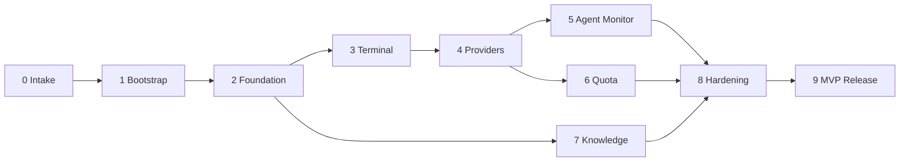

# Plano de Desenvolvimento

> Fonte da verdade do roadmap. `docs/development-plan.html` é derivado deste arquivo e deve ser atualizado na mesma mudança.

Filosofia: **IDEA → MVP → HOMOLOGAÇÃO → FEEDBACK → POLISH**. Toda fase tem início e fim claros. Iniciar fase = gate humano HG-14. Melhorias fora da fase → [[POST_MVP_BACKLOG]].

Status possíveis: `Não iniciado` · `Em andamento` · `Bloqueado` · `Em validação` · `Concluído`.

| Fase | Nome | Prioridade | Status | Progresso |
|---|---|---|---|---|
| 0 | Intake e Discovery | — | Concluído | 100% |
| 1 | Bootstrap | — | Concluído | 100% |
| 2 | Foundation | P0 | Concluído | 100% |
| 3 | Integrated Terminal (SUG03) | P0 | Concluído | 100% |
| 4 | Provider Integration | P0 | Concluído | 100% |
| 5 | Agent Monitor + Telemetria (SUG01) | P1 | Em validação | 90% |
| 6 | AI Quota Monitor (SUG02) | P1 | Não iniciado | 0% |
| 7 | Knowledge (RAG + Grafo) | P1 | Não iniciado | 0% |
| 8 | Hardening e Validação | — | Não iniciado | 0% |
| 9 | MVP Release | — | Não iniciado | 0% |

F5, F6 e F7 podem correr em paralelo após suas dependências, se a capacidade permitir.

---

## FASE 0 — Intake e Discovery
**Status:** Concluído
- **Objetivo:** transformar a ideia em definição clara de MVP.
- **Escopo:** 4 blocos do Intake; ambiente verificado.
- **Entregáveis:** [x] [[INTAKE_RECORD]] · [x] decisões de stack/arquitetura · [x] DoD do MVP.
- **Dependências:** —
- **Critérios de aceite:** [x] proposta consolidada aprovada pelo humano.
- **DoD:** gate humano de aprovação do bootstrap registrado.
- **Riscos:** spikes técnicos pendentes → migrados para as fases 2, 5, 6 e 7.

## FASE 1 — Bootstrap
**Status:** Concluído (PR #1 mergeado em `release` em 2026-10-28)
- **Objetivo:** fundação documental e operacional para desenvolvimento multi-LLM.
- **Escopo:** Vault, `.ai/`, adapters, agentes, contratos, skills, hooks, GitFlow, roadmap, HTMLs, manual, README, esqueleto do monorepo. **Sem código de produto.**
- **Entregáveis:**
  - [x] `vault/` com 16 áreas e START_HERE
  - [x] `.ai/` (workflow, agentes, contratos, skills, hooks, prompts, templates, adapters, estado)
  - [x] `CLAUDE.md`, `AGENTS.md`, `.claude/`, `.agents/`
  - [x] `.githooks/` e `scripts/`
  - [x] `docs/development-plan.html` e `docs/ai-development-system.html`
  - [x] [[AI_DEVELOPMENT_MANUAL]] e README
  - [x] ADR-0001 a ADR-0011
  - [x] PR `feature/00-bootstrap → release` aprovado e mergeado (#1)
- **Dependências:** Fase 0.
- **Critérios de aceite:** [x] `scripts/validate-bootstrap.sh` passa · [x] revisão humana do PR.
- **DoD:** PR mergeado em `release`; status e handoff atualizados.
- **Riscos:** documentação excessiva → mitigado pela regra de documentação mínima útil.

## FASE 2 — Foundation (P0)
**Status:** Concluído — PR #2 aprovado e mergeado em `release` em 2026-10-28 (merge `4d56b3d`)
- **Objetivo:** aplicação instalável e segura que sobe, autentica, abre o dashboard e gerencia projetos.
- **Escopo:** tooling (TS strict, ESLint, Prettier, Vitest, Playwright) · CI GitHub Actions · proteção de branches (HG-11) · `apps/server` Fastify com `core` (config, diretório de dados, segredo, sessão — ADR-0007, logger, redator, `ProcessRunner`, migrações SQLite) · `apps/web` Angular shell + design system base + temas · módulo `projects` · CLI `devtools start` / `devtools doctor` (detecção básica).
- **Fora do escopo:** terminal, agentes, cotas, RAG.
- **Entregáveis:**
  - [x] Spike S-01 e ADR-0012 aceito (HG-07)
  - [x] ADR-0007 aceito (HG-05/06) e implementado
  - [x] Tooling: TypeScript 6 strict, ESLint, Prettier, Vitest, Playwright
  - [x] `core`: config, diretório de dados, segredo, sessões, Host/Origin/CSRF, CSP, redator, `ProcessRunner`, SQLite + migrações
  - [x] Módulos `session`, `projects`, `system` (health, doctor)
  - [x] CLI `devtools start` / `devtools doctor`
  - [x] Dashboard Angular: acesso, projetos, detalhe, diagnóstico, temas claro/escuro, layout responsivo
  - [x] Workflow de CI (`.github/workflows/ci.yml`)
  - [x] CI verde no GitHub (run 40797299745, 59 s)
  - [x] Proteção de `main` e `release` (HG-11): PR obrigatório, check **Validação**, sem force-push/exclusão
- **Dependências:** Fase 1; spike **S-01** (node-pty/prebuilds e driver SQLite) no início da fase.
- **Critérios de aceite:**
  - [x] Servidor só aceita conexões em `127.0.0.1` (teste `server.test.ts` + `config.test.ts`).
  - [x] Requisições sem sessão → 401; `Origin`/`Host` inválidos → 403 (`security.test.ts`).
  - [x] Segredo com permissão 0600; ausente de logs, URLs e bundle (`secret.test.ts`, `security.test.ts`, E2E).
  - [x] Cadastro de projeto persiste após reinício (`projects.test.ts` + E2E com reinício real).
  - [x] Core inicia sem Ollama/Graphify (`server.test.ts`; Graphify ausente na máquina de referência).
  - [x] CI executa lint, typecheck, unit, integration, build e E2E — verde no GitHub (52 + 5 testes, 5 E2E).
- **Resultado local (2026-10-28):** 52 testes no servidor, 5 no dashboard e 5 E2E passando; `pnpm audit --prod` sem vulnerabilidades; pacote npm instalado globalmente em prefixo isolado e executado sem compilação.
- **DoD:** critérios atendidos, revisão de segurança sem bloqueantes, ADR-0007 **Aceito** (HG-05/06), docs atualizadas.
- **Riscos:** R-03 (deps nativas), R-07 (tempo de setup de tooling).

## FASE 3 — Integrated Terminal / SUG03 (P0)
**Status:** Concluído — terminal validado pelo humano e PR #4 mergeado em `release` em 2026-10-28 (merge `8203d60`)
- **Objetivo:** terminal real no navegador, estável e seguro.
- **Escopo:** `node-pty` + `xterm.js` · WS `/ws/terminal` autenticado · múltiplas abas · resize · reconexão com buffer · `cwd` do projeto · encerramento limpo de árvores de processo · retenção de sessões desconectadas.
- **Entregáveis:**
  - [x] Módulo `terminal`: `PtyBackend` híbrido (ADR-0012), `TerminalManager`, buffer de reconexão, migração 2 (`terminal_sessions`)
  - [x] REST `/projects/:id/terminals` e `DELETE /terminals/:id`; WS `/ws/terminal/:id` autenticado
  - [x] Encerramento da árvore de processos (descendentes + sessão POSIX) ao fechar, ao sair do shell, ao remover o projeto e ao desligar o servidor
  - [x] Dashboard: abas por projeto, aba ativa na URL, reconexão automática com backoff, resize, temas, links clicáveis
  - [x] `devtools doctor` e `/health` informam o backend de PTY
  - [x] Testes: 16 de integração/unidade com PTY real + 2 E2E
- **Dependências:** Fase 2.
- **Critérios de aceite:**
  - [x] `vim`, `htop`, `claude`, `codex` funcionam interativamente — `htop`, `vi` e `less` verificados no navegador; terminal validado pelo humano no ambiente de desenvolvimento.
  - [x] Recarregar a página reconecta à mesma sessão com saída recente (`terminal.test.ts` + E2E).
  - [x] WS sem sessão/Origin inválida é recusado (`terminal.test.ts`: 401 sem sessão ou cookie forjado, 403 sem Origin ou com Origin externa).
  - [x] Sessões de projetos diferentes isoladas (`terminal.test.ts`).
  - [x] Nenhum processo órfão após encerrar sessão/servidor (`terminal.test.ts`: fechar aba, `exit`, remover projeto, desligar servidor).
- **Decisões da fase:** retenção de sessão desconectada **8 h** (agente segue trabalhando com o navegador fechado); sessão encerrada fica listada 10 min; buffer de reconexão 256 KiB por terminal; máximo de 32 terminais; cliente lento (>4 MiB pendentes) é desconectado e reconecta com replay.
- **DoD:** E2E do terminal no CI; revisão de segurança aprovada (HG-06).
- **Riscos:** comportamento de PTY no CI; consumo de memória do buffer.

## FASE 4 — Provider Integration (P0)
**Status:** Concluído — PR #6 aprovado e mergeado em `release` em 2026-10-28 (merge `6455d2f`)
- **Objetivo:** detectar e iniciar Claude Code e Codex pela plataforma.
- **Escopo:** `ProviderAdapter` (claude-code, codex, ollama-detecção) · versões e capacidades · estado de autenticação via mecanismos documentados · atalhos "Abrir Claude/Codex neste projeto" no terminal · tela de provedores.
- **Entregáveis:**
  - [x] Módulo `integrations`: `ProviderAdapter` para `claude-code`, `codex` e `ollama` (detecção), cache de 60 s, falha isolada por adapter
  - [x] Login via comandos oficiais: `claude auth status --json` (só `loggedIn`, `authMethod`, `subscriptionType`) e `codex login status`; Ollama via API local documentada
  - [x] `GET /api/v1/providers` (`?refresh=1`); `doctor` (CLI e dashboard) com login real
  - [x] Tela **Provedores**; botões "Abrir Claude Code/Codex" no projeto e na barra de abas do terminal
  - [x] ESLint proíbe `fs`/SQLite no módulo `integrations` (INV-02)
  - [x] Testes de contrato com fixtures anonimizadas por versão (`apps/server/test/fixtures/<provedor>/<versão>/`)
- **Dependências:** Fase 3.
- **Critérios de aceite:**
  - [x] Ferramenta ausente → indicada como ausente, sem erro (`providers.test.ts`, E2E com Ollama ausente).
  - [x] Nenhum arquivo de credencial lido (`providers.test.ts`: allowlist de comandos executados + arquivos-isca de credencial ausentes da resposta; regra de lint).
  - [x] Claude Code e Codex iniciam no `cwd` do projeto (`terminal.test.ts` + E2E `providers.spec.ts`).
- **Decisões da fase:** o lançamento digita um comando **fixo** (`claude`/`codex`) no shell do projeto — o navegador só escolhe o provedor, nunca o texto; ao sair do provedor, o usuário continua no shell. Versões testadas: Claude Code 2.1.x, Codex 0.165.x, Ollama 0.40.x; outras versões funcionam com aviso.
- **DoD:** testes de contrato por versão; docs de integração atualizadas.
- **Riscos:** mudanças de CLI entre versões.

## FASE 5 — Agent Monitor + Telemetria básica / SUG01 (P1)
**Status:** Em validação — implementação na branch `feature/05-agent-monitor`; falta CI, revisão humana e merge
- **Objetivo:** ver agentes e subagentes trabalhando, com histórico.
- **Escopo:** spike **S-04** (fontes de eventos) · normalização em `AgentEvent` · `AgentRun`/`SubagentRun` · estados conforme [[STATE_MACHINES]] · `/ws/events` · histórico · telemetria básica (duração, tokens quando disponíveis).
- **Entregáveis:**
  - [x] Spike S-04 e [[ADR-0013-fontes-agent-monitor]]: transcrições locais do Claude Code e sessões do Codex (nível B); hooks adiados (RN-05)
  - [x] Leitores com allowlist (`integrations/sources/`): leitura incremental, parsers por provedor, descoberta por projeto
  - [x] Módulo `agents`: `AgentMonitor` (varredura de 2 s), migração 3 (`agent_runs`, `agent_events`), `GET /projects/:id/agents/runs`, `GET /agents/runs/:id`, WS `/ws/events`
  - [x] Vínculo sessão ↔ terminal: `claude --session-id <uuid>`; Codex por janela de tempo
  - [x] Telemetria básica: duração, tokens (entrada, saída, cache lido/gravado — calculado), chamadas de ferramenta por nome, modelo e versão
  - [x] Tela **Agentes** (seletor de projeto, estados com explicação, subagentes, fonte e nível, atualização ao vivo) e card no detalhe do projeto
  - [x] "Ver terminal" abre só o terminal do agente (`/agentes/:runId/terminal`), com estado ao vivo; vínculo preservado após reinício do servidor
  - [x] Testes: 23 de servidor (allowlist, tail, parsers, monitor, rotas, WS), 3 de formatação no dashboard e 1 E2E
- **Dependências:** Fase 4.
- **Critérios de aceite:**
  - [x] Distingue agente com terminal de subagente só com eventos (`kind`, `parentRunId`, `terminalId`; `agents.test.ts` vincula a sessão aberta pela suíte ao terminal).
  - [x] Sem evento → estado `Desconhecido`/`INDISPONÍVEL`, nunca inferido (`deriveState` com limite de frescor; reinício marca `unknown`; tokens ausentes → `INDISPONÍVEL`).
  - [x] Payloads redigidos antes de persistir (teste verifica que prompts, saídas e segredos das fixtures não chegam ao banco nem à tela).
  - [x] Fixtures de contrato para cada fonte/versão suportada (Claude Code 2.1.312, Codex 0.165.0).
- **Resultado local (2026-10-28):** varredura das 240 sessões e subagentes reais da máquina de referência em ~0,4 s (incremental); 102 testes no servidor, 8 no dashboard e 11 E2E passando.
- **Decisões da fase:** D-12 (limites de frescor 5/30 min) e D-13 (`--session-id`). Sessão principal sem evento de fim → `Aguardando`/`Desconhecido` (TD-12).
- **DoD:** monitor confiável em sessão real com subagentes paralelos.
- **Riscos:** R-01 (formatos instáveis); possível necessidade de instalar hooks no projeto (RN-05, autorização).

## FASE 6 — AI Quota Monitor / SUG02 (P1)
**Status:** Não iniciado
- **Objetivo:** mostrar limites e renovações com honestidade sobre a origem do dado.
- **Escopo:** spike **S-05** (fontes de uso/limites) · `QuotaReading` com categoria e frescor · agendamento periódico · UI compacta.
- **Entregáveis:** painel de cotas Claude Code e Codex.
- **Dependências:** Fase 4.
- **Critérios de aceite:**
  - [ ] Todo valor exibe fonte, horário, categoria e frescor.
  - [ ] Fonte indisponível → `INDISPONÍVEL` com motivo.
  - [ ] Nenhuma API não documentada ou scraping.
- **DoD:** dados verificáveis ou indisponibilidade explícita (DoD MVP item 7).
- **Riscos:** R-02 (pouca informação oficial para planos de assinatura).

## FASE 7 — Knowledge: RAG + Grafo (P1)
**Status:** Não iniciado
- **Objetivo:** indexar projetos localmente e responder consultas com referências verificáveis.
- **Escopo:** spikes **S-02** (Graphify) e **S-03** (vetores + embeddings) · `EmbeddingProvider` (ONNX, Ollama) · `VectorStore` · exclusões · chunking · consulta com referências · remover/reconstruir índice · `CodeGraphProvider`.
- **Entregáveis:** indexação e consulta no dashboard; ADR-0006 **Aceito**.
- **Dependências:** Fase 2 (pode correr em paralelo a 3–6).
- **Critérios de aceite:**
  - [ ] Pelo menos um mecanismo de embeddings local validado.
  - [ ] Respostas citam arquivo e linhas existentes.
  - [ ] Arquivos sensíveis nunca indexados (teste).
  - [ ] Nenhuma chamada de rede externa durante indexação (teste).
  - [ ] Índices isolados por projeto; remoção funciona.
- **DoD:** indexação de um repositório Angular + Spring Boot real em tempo aceitável na máquina de referência.
- **Riscos:** R-04 (Graphify/Python), R-05 (CPU/RAM).

## FASE 8 — Hardening e Validação
**Status:** Não iniciado
- **Objetivo:** provar a Definition of MVP Done.
- **Escopo:** E2E das jornadas · instalação em Linux limpo · testes de persistência/upgrade · revisão de segurança completa · documentação de instalação/operação · validação em projeto real Angular + Spring Boot.
- **Entregáveis:** relatório de validação da DoD (12 itens).
- **Dependências:** Fases 5, 6, 7.
- **Critérios de aceite:** todos os 12 itens da DoD em [[MVP_SCOPE]] verificados.
- **DoD:** relatório aprovado pelo humano.
- **Riscos:** descoberta tardia de problemas de empacotamento → mitigado por `pnpm pack` no CI desde a Fase 2.

## FASE 9 — MVP Release
**Status:** Não iniciado
- **Objetivo:** publicar `v0.1.0`.
- **Escopo:** `0.1.0-next.N` no canal `next` → validação → promoção `latest` · merge `release → main` · tag · notas de release.
- **Dependências:** Fase 8.
- **Critérios de aceite:** instalação via npm em máquina limpa reproduz a jornada principal.
- **DoD:** HG-01, HG-02, HG-03 aprovados; [[RELEASES]] atualizado.
- **Riscos:** nome do pacote (H-03).
