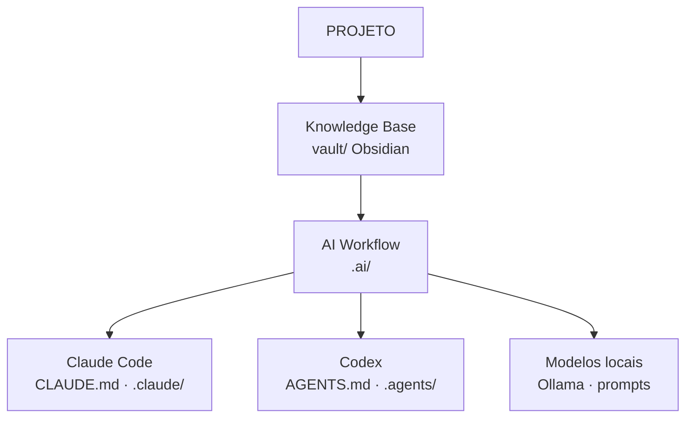

# Visão do Sistema de Desenvolvimento com IA

O workflow pertence ao projeto; LLMs são executores intercambiáveis ([[ADR-0011-vault-e-workflow-multi-llm]]).

| Componente | Onde |
|---|---|
| Agentes | `.ai/agents/` — Orchestrator, Explorer, Reporter, Architect, backend/frontend-developer, DevOps, QA, Reviewer, Security Engineer |
| Contratos | `.ai/contracts/` |
| Skills | `.ai/skills/` (+ wrappers `.claude/skills`, `.agents/skills`) |
| Hooks | `.githooks/` + `.ai/hooks/HOOKS.md` |
| MCPs | [[MCPS]] |
| Modelos | [[MODEL_STRATEGY]] · [[LLM_ENVIRONMENTS]] |
| Gates | [[HUMAN_GATES]] |
| Estado/handoff | `.ai/state/AI_DEVELOPMENT_STATE.md` |

## Fluxo de contexto
O Orchestrator nunca repassa o histórico inteiro. Explorer encontra os trechos; cada agente recebe um `TASK_CONTRACT` com referências específicas. Princípio: **contexto mínimo suficiente > contexto máximo disponível**.

Visual: `docs/ai-development-system.html`.
